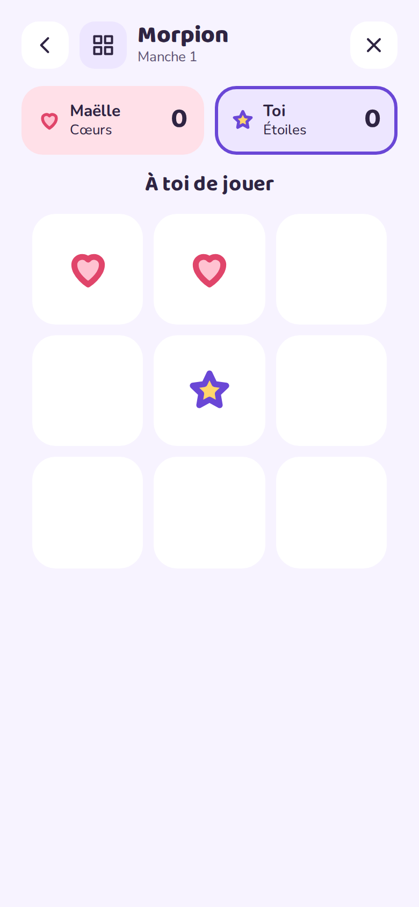

<p align="center"></p>

<h1 align="center">Papote</h1>

<p align="center"><b>Tes petits groupes, sur ton propre serveur.</b><br>
Une messagerie douillette et auto-hébergée pour la famille et les amis : une app Android, une app web installable (PWA) pour iPhone et ordinateur, et un seul conteneur Docker.</p>

<p align="center">
<a href="https://mrddream.github.io/Papote/fr/">Site</a> ·
<a href="#installation-rapide-docker-compose">Installer</a> ·
<a href="https://github.com/MrDDream/Papote/releases/latest">APK Android</a> ·
<a href="README.md">English</a>
</p>

<p align="center">
<a href="https://github.com/MrDDream/Papote/pkgs/container/papote"></a>
<a href="https://github.com/MrDDream/Papote/releases/latest"></a>
<a href="https://github.com/MrDDream/Papote/actions/workflows/tests.yml"></a>
<a href="LICENSE"></a>
</p>

<p align="center">



</p>

On rejoint un groupe avec un code d'invitation à 6 caractères (ou un QR code). Messages, photos, vocaux et dessins restent sur ton serveur : pas de compte chez un tiers, pas de services Google, aucun pistage.

## Fonctions

- **Discussion** : texte, photos, vocaux avec forme d'onde, dessins, emoji (les mêmes emoji Noto partout), réactions (intégrées + n'importe quel emoji), indicateur « écrit… » en direct, messages épinglés, recherche (textes et vocaux transcrits), galerie avec « il y a un an jour pour jour ».
- **Le côté ludique** : Bubu, la mascotte qui réagit au groupe (endormie, contente, surexcitée, en fête, étonnée), stories de 24 h, sondages, partage de position *sans service de carte*, bandeau et confettis d'anniversaire, récap du mois avec médailles, stickers du groupe et favoris, GIF via GIPHY (toujours relayés par ton serveur).
- **Dessin** : pinceau, feutre, gomme, pot de peinture, tampons ; timelapse ; « dessiner dessus » une photo ; une **toile commune** où tout le monde dessine en même temps.
- **Mini-jeux** : Morpion, Puissance 4, Chifoumi, Pendu, « Qui a dit ça ? » (avec vos vieux messages) et Pictionary en direct.
- **Vocaux** : vitesse de lecture, filtres de voix (souris, robot, écho, géant), mode talkie, transcription en option par un conteneur **Whisper** sur ta machine.
- **Photos** : décorées avant l'envoi (texte, stickers, dessin, recadrage, filtres), ou éphémères (effacées au bout de 24 h).
- **Groupes** : couleurs, 20 icônes ou une image, motifs de fond, réactions rapides propres au groupe, rôles (créateur·rice / admin / membre), validation des nouveaux, sourdine, export en `.zip`, discussions à deux.
- **Un compte, plusieurs appareils**, avec un code personnel permanent (et son QR code), fusion de comptes, 2FA en option, verrouillage de l'app (code ou empreinte) sur Android.
- **Notifications sans Google** : l'app Android garde sa propre connexion ; les navigateurs et la PWA iPhone reçoivent du Web Push, chiffré pour le navigateur.
- **Admin web** (`/admin`) : tableau de bord, santé du serveur, stockage, **sauvegarde & restauration**, journal filtrable, codes d'invitation, membres, groupes avec une **corbeille de 30 jours**, 2FA, liste d'adresses autorisées. L'admin ne voit jamais le contenu des groupes.

## Installation rapide (Docker Compose)

Il faut une machine avec Docker et Docker Compose. L'image [`ghcr.io/mrddream/papote`](https://github.com/MrDDream/Papote/pkgs/container/papote) est publiée pour `linux/amd64` et `linux/arm64` (Raspberry Pi 4/5).

Crée un dossier avec ce `docker-compose.yml` :

```yaml
services:
  papote:
    image: ghcr.io/mrddream/papote:latest
    container_name: papote
    restart: unless-stopped
    ports:
      - "127.0.0.1:3000:3000"        # port de l'hôte à gauche : change-le si 3000 est déjà pris ;
                                     # "3000:3000" si le reverse proxy est sur une autre machine
    environment:
      ADMIN_PASSWORD: ${ADMIN_PASSWORD}  # dans .env, 12 caractères ou plus
      TZ: Europe/Paris
      BACKUP_DIR: /backups
      TRUST_PROXY: loopback, uniquelocal
      SECURE_COOKIES: "true"           # "false" seulement pour tester en HTTP
      # GIPHY_API_KEY: ta-clé          # en option : les GIF
    volumes:
      - ./data:/data
      - ./backups:/backups
```

et un `.env` à côté :

```bash
ADMIN_PASSWORD=un-long-mot-de-passe-a-toi
```

Le [`docker-compose.yml` complet](docker-compose.yml) du dépôt contient toutes les options (sauvegardes, adresses autorisées pour l'admin, conteneur Whisper en option…) avec son [`.env.example`](.env.example). Pour l'utiliser directement :

```bash
mkdir papote && cd papote
curl -LO https://raw.githubusercontent.com/MrDDream/Papote/main/docker-compose.yml
curl -L -o .env https://raw.githubusercontent.com/MrDDream/Papote/main/.env.example
```

Puis démarre et lis le premier code d'accès :

```bash
docker compose up -d
```

```bash
docker compose logs papote
```

Au premier démarrage, le journal affiche le **code d'accès au serveur** pour la première personne (`Code d'accès pour la première personne : K7P-2Q9`). Le même code est sur le tableau de bord de l'admin, qui permet de le régénérer.

- App web : `http://<ton-serveur>:3000/web/` (port et adresse : `PORT` et `BIND_ADDRESS` dans `.env` ; par défaut le port n'écoute que sur `127.0.0.1`, pour un reverse proxy sur la même machine).
- Admin : `http://<ton-serveur>:3000/admin`
- Android : installe l'APK de la [dernière version](https://github.com/MrDDream/Papote/releases/latest), puis entre l'adresse du serveur et le code.

**Mettre à jour**

```bash
docker compose pull && docker compose up -d
```

Une sauvegarde est faite automatiquement toutes les 24 h. Pour en faire une juste avant une mise à jour : `docker exec papote node src/cli.js backup`.

### Derrière un reverse proxy (HTTPS)

Les navigateurs exigent le HTTPS pour installer l'app web et envoyer des notifications. N'importe quel reverse proxy convient : il doit laisser passer le WebSocket (`/ws`) et des envois de 16 Mo.

Caddy (WebSocket et en-têtes gérés tout seuls), avec l'admin joignable seulement depuis le réseau local :

```
papote.example.com {
    @admin_dehors {
        path /admin /admin/*
        not remote_ip 192.168.0.0/16 10.0.0.0/8
    }
    respond @admin_dehors 404
    reverse_proxy 127.0.0.1:3000
}
```

nginx :

```nginx
location / {
    proxy_pass http://127.0.0.1:3000;
    proxy_http_version 1.1;
    proxy_set_header Upgrade $http_upgrade;
    proxy_set_header Connection "upgrade";
    proxy_set_header Host $host;
    proxy_set_header X-Forwarded-For $proxy_add_x_forwarded_for;
    proxy_set_header X-Forwarded-Proto $scheme;
    client_max_body_size 16m;
}
```

Le serveur ne croit `X-Forwarded-For` que s'il vient d'une adresse de `TRUST_PROXY` (par défaut : adresses locales et privées). Si le proxy est sur une autre machine, mets `BIND_ADDRESS=0.0.0.0` et vérifie que son adresse est couverte par `TRUST_PROXY`.

### Configuration (`.env`)

| Variable | Défaut | |
|---|---|---|
| `ADMIN_PASSWORD` | *(vide)* | Mot de passe de l'admin, 12 caractères ou plus. Vide = admin désactivée. |
| `ADMIN_ALLOWED_IPS` | *(vide)* | IP ou plages CIDR autorisées à ouvrir `/admin` (séparées par des virgules). Ailleurs, `/admin` répond 404. |
| `ADMIN_REQUIRE_2FA` | `false` | `true` : l'admin ne montre que la page Sécurité tant que la 2FA n'est pas configurée. |
| `SERVER_NAME` | `Papote` | Nom affiché dans les apps. |
| `PORT` / `BIND_ADDRESS` | `3000` / `127.0.0.1` | Port et adresse sur l'hôte. `0.0.0.0` si le proxy est sur une autre machine. |
| `TRUST_PROXY` | `loopback, uniquelocal` | Adresses du proxy autorisées à fixer `X-Forwarded-For` (une liste, jamais un nombre). `0` sans proxy. |
| `SECURE_COOKIES` | `true` | Cookie admin en HTTPS seulement. `false` uniquement pour tester en HTTP. |
| `BACKUP_EVERY_HOURS` / `BACKUP_KEEP` | `24` / `14` | Sauvegardes automatiques (0 = désactivées) et combien en garder. |
| `BACKUP_HOST_DIR` | `./backups` | Où écrire les sauvegardes sur l'hôte. Idéalement un autre disque ou un NAS. |
| `TZ` | `Europe/Paris` | Fuseau horaire pour les anniversaires et le récap du mois. |
| `GIPHY_API_KEY` | *(vide)* | Clé gratuite sur [developers.giphy.com](https://developers.giphy.com). Vide = pas de GIF. |
| `COMPOSE_PROFILES` | *(vide)* | `whisper` lance aussi le conteneur de transcription (son image n'est téléchargée que dans ce cas). |
| `WHISPER_MODEL` / `WHISPER_LANGUAGE` | `small` / `fr` | Modèle Whisper (`base`, `small`, `medium`…) et langue des vocaux. |
| `VAPID_SUBJECT`, `VAPID_PUBLIC_KEY`, `VAPID_PRIVATE_KEY` | *(générées)* | Clés Web Push, créées une fois dans `data/vapid.json`. |
| `SESSION_SECRET` | *(généré)* | Secret de session de l'admin, sinon créé dans `data/session.secret`. |

### En option : GIF et transcription des vocaux

- **GIF** : mets ta clé dans `GIPHY_API_KEY` et lance `docker compose up -d`. Recherches et aperçus passent par ton serveur, qui garde aussi les GIF envoyés : GIPHY ne voit jamais tes membres.
- **Transcription** : mets `COMPOSE_PROFILES=whisper` et lance `docker compose up -d`. L'image [whisper-asr-webservice](https://github.com/ahmetoner/whisper-asr-webservice) (~2 Go) est téléchargée et démarrée à côté de Papote ; les vocaux sont transcrits un par un, sur ta machine. Le modèle `small` demande environ 1 à 2 Go de mémoire.

## Données, sauvegardes et restauration

Tout est dans `./data` : `papote.db` (SQLite) et `media/`. Garde ce dossier sur un **disque local** (pas de NFS/SMB, pas de dossier synchronisé).

Les sauvegardes automatiques écrivent une copie cohérente de la base et les médias (copiés une seule fois chacun) dans `BACKUP_HOST_DIR`. L'admin les liste, permet d'en lancer une et d'en **restaurer** une : l'état actuel est d'abord sauvegardé, puis le serveur remet l'instantané et redémarre (Docker le relance). L'admin ne peut pas télécharger les sauvegardes : elles contiennent tous les messages.

En ligne de commande :

```bash
docker exec papote node src/cli.js backup
docker exec papote node src/cli.js list-backups
docker compose stop papote
docker compose run --rm papote node src/cli.js restore papote-2026-01-01T03-00-00-000.db
docker compose start papote
```

Maintenance de l'admin : `docker exec papote node src/cli.js admin-reset-2fa` (téléphone perdu) et `docker exec papote node src/cli.js admin-logout-all`.

## Sécurité et vie privée

- L'admin web montre des compteurs, des tailles et des noms — jamais de messages, photos, vocaux ou dessins. Les codes d'invitation créés par les membres pour leurs groupes y sont masqués.
- Admin : mot de passe + 2FA TOTP en option avec codes de secours, sessions côté serveur, blocage après des échecs répétés, liste d'adresses autorisées, journal (90 jours), CSP stricte (aucun script en ligne), pas de cache.
- Membres : jetons (Android) ou cookie HttpOnly `SameSite=Strict` (web) ; 2FA disponible sur les comptes ; verrouillage de l'app sur Android.
- Les messages **ne sont pas chiffrés de bout en bout** : qui contrôle le serveur (le dossier `data/`, les sauvegardes) peut les lire. Protège la machine et ses sauvegardes.
- Pas de statistiques, pas de script tiers. Le Web Push passe par le service de push de l'éditeur du navigateur, chiffré pour le navigateur (RFC 8291).

## Les apps

- **Android** (8.0 ou plus) : télécharge `Papote-vX.Y.Z-release.apk` dans les [versions](https://github.com/MrDDream/Papote/releases) et installe-le. Pour recevoir les messages app fermée, autorise les notifications et désactive l'optimisation de batterie pour Papote : l'app le propose au premier lancement. Les adresses `http://` sont acceptées sur un réseau local (l'app prévient que la connexion n'est pas chiffrée).
- **iPhone, iPad, ordinateur** : ouvre `https://<ton-serveur>/web/`. Sur iPhone, Partager → *Sur l'écran d'accueil* l'installe et active les notifications (iOS 16.4+).

## Compiler soi-même

```
papote/
├── server/      API REST + WebSocket + admin (Node 26, Express, SQLite intégré)
│   └── web/     App web / PWA servie sur /web (HTML, CSS et JS, sans étape de build)
├── android/     App Android (Kotlin, Jetpack Compose)
├── docs/        Site (GitHub Pages)
└── docker-compose.yml
```

**Image du serveur** depuis les sources :

```bash
docker compose -f docker-compose.yml -f docker-compose.build.yml up -d --build
```

**Serveur** en développement (Node 26) :

```bash
cd server
npm install
ADMIN_PASSWORD="$(openssl rand -hex 12)" SECURE_COOKIES=false npm run dev
npm test
```

**Android** (JDK 17, SDK Android 34, `android/local.properties` avec `sdk.dir=…`) :

```bash
cd android
./gradlew assembleDebug
```

Pour une version signée, crée `android/keystore.properties` (`storeFile`, `storePassword`, `keyAlias`, `keyPassword`) ou exporte `PAPOTE_STORE_FILE`, `PAPOTE_STORE_PASSWORD`, `PAPOTE_KEY_ALIAS` et `PAPOTE_KEY_PASSWORD`, puis lance `./gradlew assembleRelease`.

**CI** (`.github/workflows`) : chaque push lance les tests du serveur et compile un APK de debug ; les push sur `main` et les tags `vX.Y.Z` construisent l'image Docker multi-architecture `ghcr.io/mrddream/papote`. L'APK signé est joint à chaque version GitHub.

## API (aperçu)

Tout ce qui est sous `/api`, sauf `/api/server`, `/api/join` et `/api/link`, demande `Authorization: Bearer <jeton>` (Android) ou le cookie de session (web, avec `X-Papote-Client: web`). Routes principales : `POST /api/join`, `POST /api/link`, `GET|PATCH /api/me`, `GET|POST /api/groups`, `GET|PATCH|DELETE /api/groups/:id`, `/api/groups/:id/{members,invites,messages,media,read,settings,pins,search,gallery,polls,location,stories,stickers,sticker,gif,games,live-draw,recap,export}`, `/api/messages/:id/{reactions/:kind,pin,vote,close,location}`, `/api/games/:id[/move]`, `/api/gifs/{trending,search}`, `/api/media/:id`, `/api/qr`.

WebSocket `/ws` : le serveur envoie `message.new`, `message.updated`, `typing`, `presence`, `member.*`, `group.*`, `user.updated`, `livedraw`, `live`, `story.*`, `sticker.*`, `game.updated` ; les clients envoient `typing` et `live` (traits de la toile commune et du Pictionary).

## Licence

Papote est un logiciel libre sous [licence GNU Affero General Public License v3.0 ou ultérieure](LICENSE). Si tu proposes une version modifiée en service à d’autres personnes, tu dois leur en fournir le code source.

## Crédits

Conçu avec Claude Design, développé avec Claude Code. Polices : Baloo 2, Nunito et Noto Color Emoji (SIL Open Font License, voir `server/public/fonts`). La transcription utilise [whisper-asr-webservice](https://github.com/ahmetoner/whisper-asr-webservice). GIF fournis par GIPHY.
