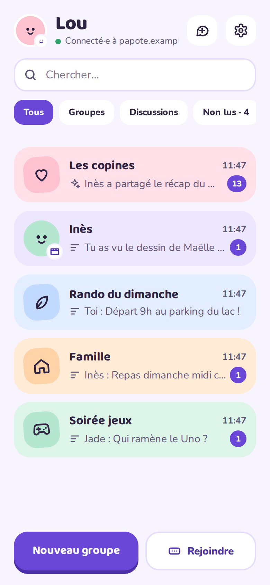
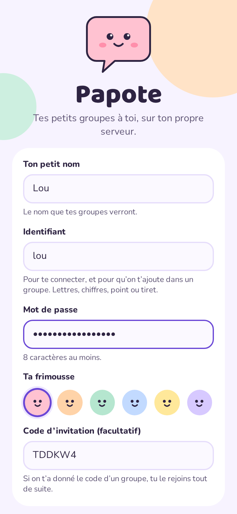
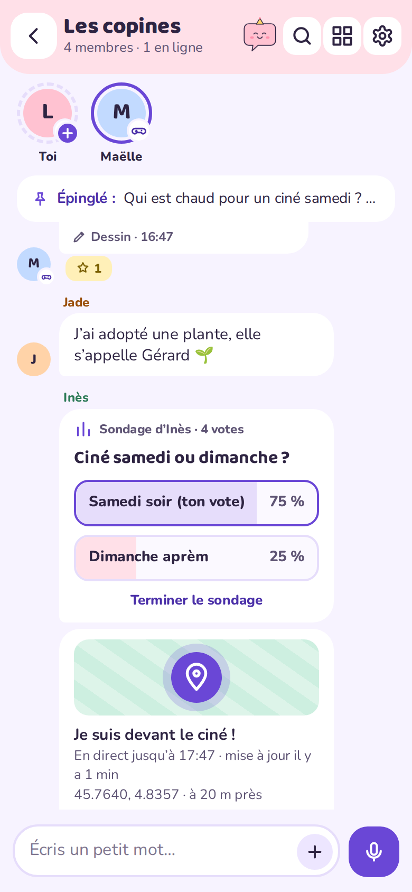

<p align="center"></p>

<h1 align="center">Papote</h1>

<p align="center"><b>Your little groups, on your own server.</b><br>
A cosy, self-hosted messenger for family and friends: an Android app, an installable web app (PWA) for iPhone and computers, and a single Docker container.</p>

<p align="center">
<a href="https://mrddream.github.io/Papote/">Website</a> ·
<a href="#quick-start-docker-compose">Install</a> ·
<a href="https://github.com/MrDDream/Papote/releases/latest">Android APK</a> ·
<a href="README.fr.md">Français</a>
</p>

<p align="center">
<a href="https://github.com/MrDDream/Papote/pkgs/container/papote"></a>
<a href="https://github.com/MrDDream/Papote/releases/latest"></a>
<a href="https://github.com/MrDDream/Papote/actions/workflows/tests.yml"></a>
<a href="LICENSE"></a>
</p>

<p align="center">




</p>

Everyone has an account (a username and a password, the same on every device); people join a group when a member adds them, or with an invitation code or QR code. Messages, photos, voice notes and drawings stay on your server: no account at a third party, no Google services, no tracking.

## Features

- **Chat**: text, photos, **videos and documents**, voice notes with waveform, drawings, emoji (the same Noto emoji everywhere), reactions (built-in + any emoji), **swipe a message to reply**, **read ticks** (sent, read by some, read by everyone), live typing indicators, pinned messages, search (text and transcribed voice notes), a gallery with "one year ago today". Tap a profile picture to see it big.
- **Share to Papote** from any app (text, links, pictures), and straight to a conversation from Android's share sheet.
- **French or English**, chosen in Settings (🇫🇷 / 🇬🇧).
- **Themes for the whole app**: pick a theme (Pastel, the original, or Starry night, Notebook, Neo-pop, Plain, Arcade, Forest: fonts and shapes change too) and its colours separately, each in light and dark. Each group picks its own background: 12 patterns (hearts, stars, waves, leaves, confetti…) or a photo.
- **The fun bits**: Bubu the mascot reacting to the group (sleepy, happy, excited, party, surprised), 24-hour stories, polls, location sharing *without any map service*, birthday banner and confetti, a monthly recap with medals, group stickers and favourites, GIFs through GIPHY (always relayed by your server).
- **Drawing**: brush, marker, eraser, bucket, stamps; timelapse replay; "draw over" a photo; a **shared live canvas** everybody paints on at once.
- **Mini-games**: Tic-tac-toe, Connect 4, Rock-paper-scissors, Hangman, "Who said that?" (from your old messages) and live Pictionary.
- **Voice**: playback speed, voice filters (mouse, robot, echo, giant), walkie-talkie mode, optional transcription by a **Whisper** container on your machine.
- **Photos**: decorate before sending (text, stickers, drawing, crop, filters), or make them disappear after 24 hours.
- **Groups**: colours, 20 icons or a picture, background patterns, the group's own quick reactions, roles (owner / admin / member), approval of newcomers, mute, export as `.zip`, two-person conversations.
- **Standard accounts**: a display name, a username and a password, the same on every device. Sign-up is open to anyone or invitation-only (admin setting); add a contact to a group in one tap, or anyone by their username (they accept an invitation). Account merge, optional 2FA, app lock (PIN or fingerprint) on Android.
- **Notifications without Google**: the Android app keeps its own connection and shows conversation notifications like the other messengers (the group's picture, the last messages, a pop-up at the top of the screen, and **bubbles** on Android 11+ to answer without opening the app); browsers and the iPhone PWA get Web Push, encrypted for the browser.
- **French or English**, chosen in the app's settings.
- **Admin web** (`/admin`): dashboard, server health, storage, **backup & restore**, journal with filters, invitation codes, members, groups with a **30-day trash**, 2FA, IP allowlist, sign-up **open or invitation-only** with **sign-up links and QR codes** that fill the code in, a **temporary password for a member** who forgot theirs or lost their phone (all their devices signed out, account 2FA removed), **new version check** (the Android app offers the new APK by itself). The admin never sees group content.

## Quick start (Docker Compose)

You need a machine with Docker and Docker Compose. The image [`ghcr.io/mrddream/papote`](https://github.com/MrDDream/Papote/pkgs/container/papote) is published for `linux/amd64` and `linux/arm64` (Raspberry Pi 4/5).

Create a folder (for example `papote/`) with this `docker-compose.yml`. It reads every setting from `.env` and includes the optional **Whisper** container for voice note transcription:

```yaml
services:
  papote:
    image: ghcr.io/mrddream/papote:latest
    container_name: papote
    restart: unless-stopped
    ports:
      # Host side from .env: BIND_ADDRESS (127.0.0.1 = only a reverse proxy on this machine) and PORT.
      - "${BIND_ADDRESS:-127.0.0.1}:${PORT:-3000}:3000"
    env_file: .env                       # every setting comes from .env (see below)
    environment:
      PORT: 3000                         # inside the container, whatever PORT says in .env
      BACKUP_DIR: /backups
      PAPOTE_PROFILES: ${COMPOSE_PROFILES:-}   # lets Papote know Whisper runs next to it
    volumes:
      - ./data:/data
      - ${BACKUP_HOST_DIR:-./backups}:/backups   # ideally another disk or a NAS

  # Voice note transcription on your machine (optional, ~1-2 GB of RAM):
  # COMPOSE_PROFILES=whisper in .env. Its image is only pulled in that case.
  whisper:
    image: onerahmet/openai-whisper-asr-webservice:v1.9.1
    container_name: papote-whisper
    profiles: ["whisper"]
    restart: unless-stopped
    environment:
      ASR_MODEL: ${WHISPER_MODEL:-small}
      ASR_ENGINE: faster_whisper
    volumes:
      - ./whisper-cache:/root/.cache
```

and a `.env` next to it:

```bash
# Admin password (/admin), 12+ characters
ADMIN_PASSWORD=a-long-password-of-your-own
# Host port and address: 127.0.0.1 when the reverse proxy is on this machine, 0.0.0.0 otherwise
PORT=3000
BIND_ADDRESS=127.0.0.1
# Behind a reverse proxy serving HTTPS
TRUST_PROXY=loopback, uniquelocal
SECURE_COOKIES=true
TZ=Europe/Paris
# Optional: GIFs (free key on developers.giphy.com) and voice transcription (empty = off)
GIPHY_API_KEY=
COMPOSE_PROFILES=whisper
# Largest video or document, in MB; new-version check against GitHub
MAX_UPLOAD_MB=20
UPDATE_CHECK=true
```

If port 3000 is already taken on the machine, change `PORT` (for example `PORT=3080`) and point your reverse proxy at it: Papote keeps listening on 3000 inside the container. Every variable is described [below](#configuration-env).

The repository's [`docker-compose.yml`](docker-compose.yml) and [`.env.example`](.env.example) do the same with every option written out. To start from them:

```bash
mkdir papote && cd papote
curl -LO https://raw.githubusercontent.com/MrDDream/Papote/main/docker-compose.yml
curl -L -o .env https://raw.githubusercontent.com/MrDDream/Papote/main/.env.example
```

Then start it:

```bash
docker compose up -d
```

```bash
docker compose logs papote
```

Then open the app and **create an account** (display name, username, password). Sign-up is open by default: in `/admin`, "Inscriptions" switches it to invitation-only (a group's code or the server access code, which the log prints on the first start and the dashboard can regenerate). Each code in `/admin` comes with a **sign-up link** and its **QR code**: they open "Create my account" with the code already filled in.

- Web app: `http://<your-server>:3000/web/` (port and address: `PORT` and `BIND_ADDRESS` in `.env`; by default the port only listens on `127.0.0.1`, for a reverse proxy on the same machine).
- Admin: `http://<your-server>:3000/admin`
- Android: install the APK from the [latest release](https://github.com/MrDDream/Papote/releases/latest), then enter your server address and sign in or create an account.

**Updating**

```bash
docker compose pull && docker compose up -d
```

A backup is made automatically every 24 hours. To make one right before an update: `docker exec papote node src/cli.js backup`.

### Behind a reverse proxy (HTTPS)

Browsers require HTTPS to install the web app and to send notifications, so put a reverse proxy with a certificate in front of Papote. Whichever you use, it must:

- **keep the `Host` header**: the sign-up links, the QR codes and the WebSocket origin check are built from it;
- **pass WebSockets** on `/ws` (messages arrive live through it);
- **accept uploads a bit larger than `MAX_UPLOAD_MB`** (25 MB with the default 20);
- **send `X-Forwarded-For` and `X-Forwarded-Proto`**, from an address listed in `TRUST_PROXY`.

Keep these in `.env` (they are the defaults):

```bash
BIND_ADDRESS=127.0.0.1             # 0.0.0.0 if the proxy runs on another machine
TRUST_PROXY=loopback, uniquelocal  # the proxy's address must be covered
SECURE_COOKIES=true
```

#### Caddy

The simplest: Caddy gets and renews the certificate on its own, and handles WebSockets and the forwarded headers. `/etc/caddy/Caddyfile`:

```caddy
papote.example.com {
    # Optional: the admin only from your local network
    @admin_outside {
        path /admin /admin/*
        not remote_ip 192.168.0.0/16 10.0.0.0/8
    }
    respond @admin_outside 404

    reverse_proxy 127.0.0.1:3000
}
```

Then `sudo systemctl reload caddy`. The `@admin_outside` block is optional: it hides `/admin` from the Internet (you can also use `ADMIN_ALLOWED_IPS`).

Caddy in Docker, in the same `docker-compose.yml` as Papote: add the service below, and write `reverse_proxy papote:3000` in the Caddyfile (the containers share a network; its `172.x` address is covered by `uniquelocal`). `BIND_ADDRESS` can stay at `127.0.0.1`.

```yaml
  caddy:
    image: caddy:2
    container_name: caddy
    restart: unless-stopped
    ports:
      - "80:80"
      - "443:443"
    volumes:
      - ./Caddyfile:/etc/caddy/Caddyfile:ro
      - ./caddy-data:/data
```

#### nginx

`/etc/nginx/sites-available/papote`, with a Let's Encrypt certificate from certbot:

```nginx
# WebSocket (/ws): upgrade only when the browser asks for it
map $http_upgrade $connection_upgrade {
    default upgrade;
    ''      close;
}

server {
    listen 80;
    listen [::]:80;
    server_name papote.example.com;
    return 301 https://$host$request_uri;
}

server {
    listen 443 ssl;
    listen [::]:443 ssl;
    http2 on;                         # nginx < 1.25.1: "listen 443 ssl http2;" instead
    server_name papote.example.com;

    ssl_certificate     /etc/letsencrypt/live/papote.example.com/fullchain.pem;
    ssl_certificate_key /etc/letsencrypt/live/papote.example.com/privkey.pem;

    client_max_body_size 25m;         # a bit more than MAX_UPLOAD_MB (20)

    proxy_http_version 1.1;
    proxy_set_header Upgrade $http_upgrade;
    proxy_set_header Connection $connection_upgrade;
    proxy_set_header Host $host;      # sign-up links, QR codes, WebSocket origin check
    proxy_set_header X-Forwarded-For $remote_addr;
    proxy_set_header X-Forwarded-Proto $scheme;
    proxy_read_timeout 1h;            # the WebSocket stays open

    # Optional: the admin only from your local network
    location /admin {
        allow 192.168.0.0/16;
        allow 10.0.0.0/8;
        deny all;
        proxy_pass http://127.0.0.1:3000;
    }

    location / {
        proxy_pass http://127.0.0.1:3000;
    }
}
```

Get the certificate first, then enable the site:

```bash
sudo certbot certonly --nginx -d papote.example.com
sudo ln -s /etc/nginx/sites-available/papote /etc/nginx/sites-enabled/
sudo nginx -t && sudo systemctl reload nginx
```

`X-Forwarded-For $remote_addr` passes the address nginx really sees, not a header the client could fill in. If you change `MAX_UPLOAD_MB`, change `client_max_body_size` with it.

**Nginx Proxy Manager**: forward to `papote:3000` (same Docker network) or to the host and `PORT`, tick *Websockets Support*, request a certificate in the *SSL* tab, and add `client_max_body_size 25m;` under *Advanced*.

#### Check

Open `https://papote.example.com/admin`: the **sign-up link** on the dashboard must start with `https://papote.example.com/`. If it shows `http://`, `127.0.0.1` or a port, the proxy isn't passing `Host` or `X-Forwarded-Proto`, or its address isn't in `TRUST_PROXY`. If messages only appear after a refresh, WebSockets (`/ws`) aren't getting through.

### Configuration (`.env`)

| Variable | Default | |
|---|---|---|
| `ADMIN_PASSWORD` | *(empty)* | Admin password, 12+ characters. Empty = admin disabled. |
| `ADMIN_ALLOWED_IPS` | *(empty)* | IPs or CIDR ranges allowed to open `/admin` (comma separated). Elsewhere `/admin` answers 404. |
| `ADMIN_REQUIRE_2FA` | `false` | `true`: the admin shows only the Security page until 2FA is set up. |
| `SERVER_NAME` | `Papote` | Name shown in the apps. |
| `PORT` / `BIND_ADDRESS` | `3000` / `127.0.0.1` | Host port and address. `0.0.0.0` when the proxy is on another machine. |
| `TRUST_PROXY` | `loopback, uniquelocal` | Proxy addresses allowed to set `X-Forwarded-For` (a list, never a number). `0` without a proxy. |
| `SECURE_COOKIES` | `true` | Admin cookie over HTTPS only. `false` only to test over plain HTTP. |
| `BACKUP_EVERY_HOURS` / `BACKUP_KEEP` | `24` / `14` | Automatic backups (0 = off) and how many to keep. |
| `BACKUP_HOST_DIR` | `./backups` | Where backups go on the host. Ideally another disk or a NAS. |
| `TZ` | `Europe/Paris` | Time zone for birthdays and the monthly recap. |
| `MAX_UPLOAD_MB` | `20` | Largest video or document ("File") a member can send. Behind nginx, raise `client_max_body_size` to match. |
| `UPDATE_CHECK` | `true` | The server checks GitHub for a new release twice a day: shown in `/admin`, and the Android app offers the new APK (it only asks your server). `false` = never contact GitHub. |
| `GIPHY_API_KEY` | *(empty)* | Free key from [developers.giphy.com](https://developers.giphy.com). Empty = no GIFs. |
| `COMPOSE_PROFILES` | *(empty)* | `whisper` also runs the transcription container (its image is only pulled then). |
| `WHISPER_MODEL` / `WHISPER_LANGUAGE` | `small` / `fr` | Whisper model (`base`, `small`, `medium`…) and the language of voice notes. |
| `VAPID_SUBJECT`, `VAPID_PUBLIC_KEY`, `VAPID_PRIVATE_KEY` | *(generated)* | Web Push keys, created once in `data/vapid.json`. |
| `SESSION_SECRET` | *(generated)* | Admin session secret, otherwise created in `data/session.secret`. |

### Optional: GIFs and voice transcription

- **GIFs**: put your key in `GIPHY_API_KEY` and run `docker compose up -d`. Searches and previews go through your server, which also keeps the GIFs that are sent: GIPHY never sees your members.
- **Transcription**: set `COMPOSE_PROFILES=whisper` and run `docker compose up -d`. The [whisper-asr-webservice](https://github.com/ahmetoner/whisper-asr-webservice) image (~2 GB) is pulled and started next to Papote; voice notes are transcribed one at a time, on your machine. The `small` model needs about 1–2 GB of RAM.

## Data, backups and restore

Everything lives in `./data`: `papote.db` (SQLite) and `media/`. Keep it on a **local disk** (not NFS/SMB, not a synced folder).

Automatic backups write a consistent copy of the database plus the media (each copied once) to `BACKUP_HOST_DIR`. The admin lists them, can start one, and can **restore** one: the current state is backed up first, then the server puts the snapshot back and restarts (Docker brings it up again). The admin cannot download backups: they contain every message.

From the command line:

```bash
docker exec papote node src/cli.js backup
docker exec papote node src/cli.js list-backups
docker compose stop papote
docker compose run --rm papote node src/cli.js restore papote-2026-01-01T03-00-00-000.db
docker compose start papote
```

Admin maintenance: `docker exec papote node src/cli.js admin-reset-2fa` (lost phone) and `docker exec papote node src/cli.js admin-logout-all`.

## Security and privacy

- The admin web shows counts, sizes and names — never messages, photos, voice notes or drawings. Invitation codes made by members for their groups are masked in the admin.
- Admin: password + optional TOTP 2FA with recovery codes, server-side sessions, lockout after repeated failures, IP allowlist, journal (90 days), strict CSP (no inline script), no caching.
- Members: bearer tokens (Android) or an HttpOnly `SameSite=Strict` cookie (web); 2FA available on accounts; app lock on Android.
- Messages are **not end-to-end encrypted**: whoever controls the server (the `data/` folder, the backups) can read them. Protect the machine and its backups.
- No analytics, no third-party scripts. Web Push goes through the browser vendor's push service, encrypted for the browser (RFC 8291).

## The apps

- **Android** (8.0+): download `Papote-vX.Y.Z-release.apk` from the [releases](https://github.com/MrDDream/Papote/releases) and install it. Later versions install over it, and the app tells you when one is out (Settings → App). Messages arrive as notifications even when the app is closed, without Google services: allow notifications when asked. Android then requires a silent “Papote stays connected” notification; tap it to hide it, the connection keeps going (Settings → Notifications). On some phones you also need to turn off battery optimisation there. Plain `http://` addresses are accepted on a local network (the app warns that the connection isn't encrypted).
- **iPhone, iPad, computers**: open `https://<your-server>/web/`. On iPhone, Share → *Add to Home Screen* installs it and enables notifications (iOS 16.4+).

The interface is in French or English (Settings → Appearance → Language).

## Build from source

```
papote/
├── server/      REST API + WebSocket + admin (Node 26, Express, built-in SQLite)
│   └── web/     Web app / PWA served on /web (plain HTML/CSS/JS, no build step)
├── android/     Android app (Kotlin, Jetpack Compose)
├── docs/        Website (GitHub Pages)
└── docker-compose.yml
```

**Server image** from source:

```bash
docker compose -f docker-compose.yml -f docker-compose.build.yml up -d --build
```

**Server** for development (Node 26):

```bash
cd server
npm install
ADMIN_PASSWORD="$(openssl rand -hex 12)" SECURE_COOKIES=false npm run dev
npm test
```

**Android** (JDK 17, Android SDK 34, `android/local.properties` with `sdk.dir=…`):

```bash
cd android
./gradlew assembleDebug
```

For a signed release, create `android/keystore.properties` (`storeFile`, `storePassword`, `keyAlias`, `keyPassword`) or export `PAPOTE_STORE_FILE`, `PAPOTE_STORE_PASSWORD`, `PAPOTE_KEY_ALIAS` and `PAPOTE_KEY_PASSWORD`, then run `./gradlew assembleRelease`.

**CI** (`.github/workflows`): every push runs the server tests and builds a debug APK; pushes to `main` and tags `vX.Y.Z` build the multi-arch Docker image `ghcr.io/mrddream/papote`. The signed APK is attached to each GitHub release.

## API (overview)

Everything under `/api` except `/api/server`, `/api/register`, `/api/login`, `/api/join` and `/api/link` needs `Authorization: Bearer <token>` (Android) or the session cookie (web, with `X-Papote-Client: web`). Main routes: `POST /api/register`, `POST /api/login`, `POST /api/join`, `POST /api/link`, `GET|PATCH /api/me`, `PUT /api/me/account`, `GET /api/me/invitations`, `GET /api/users/lookup`, `GET /api/updates`, `GET|POST /api/groups`, `GET|PATCH|DELETE /api/groups/:id`, `/api/groups/:id/{add,members,invites,messages,media,read,settings,pins,search,gallery,polls,location,stories,stickers,sticker,gif,games,live-draw,recap,export}`, `/api/messages/:id/{reactions/:kind,pin,vote,close,location}`, `/api/games/:id[/move]`, `/api/gifs/{trending,search}`, `/api/media/:id`, `/api/qr`.

WebSocket `/ws`: the server sends `message.new`, `message.updated`, `typing`, `presence`, `member.*`, `group.*`, `user.updated`, `livedraw`, `live`, `story.*`, `sticker.*`, `game.updated`; clients send `typing` and `live` (strokes of the shared canvas and Pictionary).

## License

Papote is free software under the [GNU Affero General Public License v3.0 or later](LICENSE). If you run a modified version as a service for others, you must offer them its source code.

## Credits

Designed with Claude Design, built with Claude Code. Fonts: Baloo 2, Nunito and Noto Color Emoji (SIL Open Font License, see `server/public/fonts`). Voice transcription uses [whisper-asr-webservice](https://github.com/ahmetoner/whisper-asr-webservice). GIFs powered by GIPHY.
